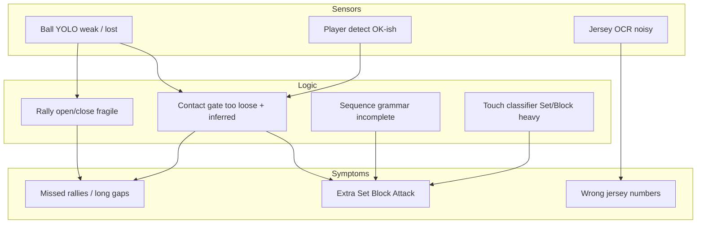

# Full-Match Accuracy Improvement Plan

**Goal:** Make VolleyScout accurate on **any** match video (5–10 min clips **and** full **1–2 hour** matches): correct event types, correct times, reliable jersey numbers (or blank), and **no missed live-play rallies**.

**Based on:** Cremonese 10‑minute match-only export review  
`output/...01_Cremonese_bmb_25_from330s_*` (`--start-sec 330 --max-seconds 600`)

**Design principle (all videos):**

```text
Operator sets match_start_sec → analyze only match play
CSV timestamps stay in original video time
Rules + models must be video-agnostic (no per-match hardcoding)
Blank jersey is preferred over a wrong number
```

---

## 1. What the latest 10‑min run proved

| Area | Status | Evidence |
|------|--------|----------|
| **Time sync** | Pass | `time_start_sec` ↔ `timestamp` ↔ `timestamp_ms` consistent; frames ≈ 30 fps; seek `t − start_sec` matches HUD |
| **Match start skip** | Pass | No events before ~334s; `_from330s` suffix works |
| **Serve-only rallies** | Much improved | **0/12** serve-only (was ~68% on older 5‑min Villadoro) |
| **Illegal Serve→Block** | Pass | **0** cases |
| **In-rally presence** | Partial | All 12 rallies have Reception + Attack + Point |
| **In-rally precision** | Fail | Set+Block = **63.5%** of touches; ~**1.4** touches/s; HUD `touch=29` mid-rally |
| **Rally recall** | Fail | Only **12** rallies in 10 min; gaps **~99s** (R2→R3) and **~161s** (R10→R11) |
| **Contact quality** | Fail | **73%** inferred contacts; many `ball_conf < 0.25` |
| **Jersey fill** | Partial | **66%** of touch rows filled |
| **Jersey correctness** | Fail | OCR errors: 23→2, 18→16/10, 8→3; **#10** on **156** tracks; live `#18` tagged as `#10` |

**Client-ready?** **No.** Sync and rally skeleton improved; precision, recall, and jersey trust are not good enough for Fabio / full-match delivery.

---

## 2. Target acceptance (must pass on every video)

Use these gates before calling a run “accurate.” Apply to a **10‑min match window** first, then a **full match (60–120 min)**.

### 2.1 Events

| Metric | Target |
|--------|--------|
| Serve-only rallies | **&lt; 10%** |
| Reception / Serve ratio | **0.85 – 1.30** |
| Same-player Serve→Reception | **0** |
| Block before first Attack in rally | **0** |
| Set+Block share of in-rally touches | **&lt; 40%** (current 63.5% too high) |
| Mean touch rate while rally active | **~0.4 – 1.2 / s** (current ~1.4 = spam) |
| Inferred-contact rate | **&lt; 35%** (current 73%) |
| Multi-minute CSV silence while play is visible | **0** |
| False Serve on dead-ball / walk-back | **≈ 0** (spot-check) |
| Point end | Within **~1 s** of ball dead / whistle (spot-check) |

### 2.2 Jerseys

| Metric | Target |
|--------|--------|
| Wrong filled jersey (spot-check) | **&lt; 10%** of filled rows |
| Blank when uncertain | Allowed / preferred |
| Single-number dominance (e.g. #10 / #30 flood) | No number &gt; **~25%** of filled touches without roster proof |
| Track ID → jersey flips in one rally | Rare; prefer blank over flip |
| Server jersey when back visible | Correct or blank — not wrong |

### 2.3 Full match (1–2 hours)

| Metric | Target |
|--------|--------|
| Memory / track growth | Stable (no unbounded jersey map / track explosion) |
| Time sync over long run | Still exact (no drift) |
| Timeouts / between-sets | No fake rallies; resume on next real serve |
| Substitutions / camera cuts | Rally recovers or safely blanks; no spam |
| Runtime | Documented; batch/offline OK for v1 |

---

## 3. Root causes (why accuracy fails)



1. **Ball track drops** → rally never opens, or contacts are **inferred** → missed rallies + fake touches.
2. **Contact cooldown / classifier** too permissive → Set/Block/Attack spam inside one rally.
3. **Serve detector** can fire on dead-ball motion → false rallies or wrong Serve time.
4. **OCR** confuses 23/2, 18/10/16, 8/3; majority vote still locks wrong; **#10 collapse**.
5. **Track ID churn** over long video → same player gets many IDs → jersey map polluted (worse on 1–2 h).

---

## 4. Workstreams (what to change)

### WS-A — Do not miss rallies (recall) — **P0**

**Problem:** 99s / 161s gaps with only 12 rallies in 10 minutes.

**Logic changes** (`volleyball_analytics/pipeline.py` / `RallyEventEngine`):

1. **Serve-gated rally start only**  
   Open rally only on serve-like evidence (baseline / toss / outbound high-speed ball after lockout), not random dead-ball contacts.
2. **Ball-loss recovery (keep rally alive)**  
   If rally is active and ball YOLO drops briefly, keep rally open; resume contacts when ball returns. Do **not** emit Point solely because of short miss streaks.
3. **Gap watchdog**  
   If `active=False` for &gt; N seconds but court still shows serve formation / inbound ball, force a serve re-detect path (debug log reason).
4. **Timeout / between-set mode**  
   Detect prolonged dead ball (low motion, ball on floor, players walking) → suppress Serve; clear lockout only when serve-like motion returns.
5. **Dual criteria for Point**  
   Point = (dead ball + no legal contact for `T` s) **or** (ball out of court / floor bounce with speed collapse) — not walk-back tracking.

**Model / data:**

- **Retrain or fine-tune ball YOLO** on match footage (Cremonese + other holdouts): serve toss, spike, net, floor, far-court, occlusion.
- Add hard negatives: scoreboard reflections, head blobs, far spectators.
- Keep Kalman, but **reset on Point** and reduce trust of long pure-predict coasts (today inferred=73%).

**Acceptance:** On Cremonese `start=330, max=600`, no multi-minute silence while play is visible; Serve count roughly matches real points in that window (manual count).

---

### WS-B — Stop fake / spam events (precision) — **P0**

**Problem:** Too many Set/Block/Attack; `touch=29` in one rally; 63% Set+Block.

**Logic changes:**

1. **Raise contact bar**  
   Prefer measured YOLO ball near player; inferred contacts only if trajectory inflection + player proximity + min speed change.
2. **Per-touch cooldown by event type**  
   e.g. min gap after Attack before next Attack; Set cannot chain 4× on same track in &lt;1 s.
3. **Stronger volleyball grammar** (extend `RallySequenceNormalizer`):

   ```text
   Serve → Reception → (Set) → Attack → (Block|Dig) → (Set) → Attack → … → Point
   ```

   - After Serve: only Reception / Dig (never Block).
   - Block only after Attack in same rally.
   - Collapse duplicate same-type / same-track within 0.5–0.6 s → keep best conf.
4. **Label priorities from ball physics**  
   High outbound speed near net → Attack; soft upward near setter zone → Set; first inbound after Serve → Reception.
5. **Cap touches per rally** with soft filter (debug flag) to catch runaway spam in CI.

**Model:** Optional later — small touch/event classifier on contact crops; **not required** if rules + better ball fix spam.

**Acceptance:** Set+Block &lt; 40% of touches; mean touch rate in band; spot-check 10 rallies with Fabio checklist.

---

### WS-C — Jersey numbers correct or blank — **P0**

**Problem:** Wrong OCR shipped to CSV; #10 dominance; 18↔10; 23↔2.

**Logic changes** (`JerseyReader` / export):

1. **Blank-over-wrong**  
   Raise `jersey_export_min_conf`; if top-2 OCR candidates conflict (e.g. 10 vs 18), emit **blank**.
2. **Anti-dominance**  
   Cap how often one number can be assigned across many track IDs without spatial continuity.
3. **Digit confusions blacklist**  
   Treat pairs `(2,23), (1,7), (8,3), (10,18), (16,18)` as needing extra conf or second view.
4. **OCR at touch time**  
   Prefer crops ±3 frames around contact; don’t lock jersey from warm-up / sideline before `start_seconds`.
5. **Roster (optional but recommended)**  
   `--roster 1,3,6,7,8,9,10,12,18,23,...` — reject out-of-roster numbers.
6. **One jersey visible per player box**  
   Unique number per frame among overlapping boxes.
7. **Track → jersey stability**  
   Require K agreeing reads before confirm; on flip, blank until reconfirmed.

**Model / data:**

- Collect **jersey crop dataset** from holdouts (already have `output/jersey_crops/`) with human labels.
- Fine-tune OCR path (EasyOCR settings / digit model) or train a **small jersey digit CNN** on torso crops.
- Prefer rear-torso crops; reject side/blur via existing `frame_quality_score`.

**Acceptance:** Spot-check ≥50 filled jersey rows; wrong &lt; 10%; no #10 flood; server number correct or blank when back is clear.

---

### WS-D — Full-match (1–2 h) robustness — **P1**

**Problem:** Clip tuning may break or explode on long matches.

**Logic / engineering:**

1. **Streaming state**  
   Bound track maps; expire dead track IDs; don’t keep 500+ jersey entries forever without pruning.
2. **Segmented processing (optional)**  
   Process in N‑minute chunks with carry-over: score, last rally state, confirmed jersey roster — merge CSV with continuous `event_id` / `rally_id`.
3. **Camera / cut handling**  
   On large scene change: reset ball Kalman; keep jersey roster; require new serve to open rally.
4. **Performance**  
   Jersey OCR every K frames or only near contacts; ball/player at full rate.
5. **Ops contract**  
   Always require `start_seconds` (and optional `end_seconds`) for uploads; document for 1–2 h jobs.

**Acceptance:** One full holdout match (or ≥45 min) export completes; metrics above still hold; memory stable.

---

### WS-E — Models to retrain / upgrade

| Model | Priority | Why | Data |
|-------|----------|-----|------|
| **Ball YOLO** | **P0** | Lost ball → missed rallies + inferred spam | Match frames: serve, attack, dig, floor, far side; hard negatives |
| **Player YOLO** | P1 | Sideline / PIP / coach boxes steal contacts | Negatives: coaches, referee stand, picture-in-picture |
| **Jersey OCR / digit model** | **P0** | Wrong numbers in CSV | Labeled `jersey_crops` + roster-aware training |
| Event/touch classifier | P2 | Only if rules cannot cut Set/Block spam | Contact crops + label |

**Retrain loop (every video family):**

```text
1. Export debug MP4 + crops on new holdout
2. Label gold CSV for 10–20 rallies (Serve/Reception/Set/Attack/Block/Dig/Point + jersey)
3. Fine-tune ball (+ jersey) 
4. Re-export same window
5. Compare metrics in §2
```

Do **not** retrain as the first response to grammar bugs — fix rules first, then retrain sensors.

---

### WS-F — Evaluation & QA (so “all videos” stay honest) — **P0**

1. Fix/run `python -m volleyball_analytics.evaluation` (pandas env) on every export:

   - serve-only %, Reception/Serve, jersey fill, dominance, gap report, touch rate
2. Add **gap report**: list inter-rally gaps &gt; 30s with start/end timestamps for human review.
3. Add **gold scoring** path: `--ground-truth labels/<stem>_gold.csv --tolerance-sec 0.5`.
4. **Mandatory two-video gate** before client:

   - Cremonese (or current) with its `start_seconds`
   - Second holdout with a **different** `start_seconds`
5. Keep `FIVE_MIN_REVIEW_GUIDE.md` workflow; extend checklist for full match (timeouts, set changes).

---

## 5. Phased delivery order

### Phase 0 — Baseline lock (1 day)

- Freeze this Cremonese `_from330s` CSV/MP4 as **before** baseline.
- Document metrics from §1 in the PR / review notes.
- Ensure evaluation script runs in project env.

### Phase 1 — Recall + precision rules (P0 logic, no retrain yet)

1. Serve-only rally open + dead-ball suppress  
2. Ball-loss recovery / Point dual criteria  
3. Contact tightening + duplicate collapse  
4. Grammar: Serve→Reception; Block only after Attack; Set/Attack cooldowns  

**Exit:** Gaps shrink on visual play; Set+Block &lt; 45%; no Serve→Block; touch rate down.

### Phase 2 — Jersey trust (P0)

1. Blank-over-wrong + confusion pairs + anti-dominance  
2. OCR at touch; roster support on API/CLI  
3. Label 200–500 jersey crops; tune thresholds  

**Exit:** Wrong filled jersey &lt; 10% on spot-check; no #10/#30 flood.

### Phase 3 — Ball (+ optional player) retrain

1. Build ball dataset from holdouts + autolabel cleanup  
2. Train/val; deploy weights in `weights/`  
3. Re-export Cremonese 10‑min + second video  

**Exit:** Inferred contacts &lt; 35%; Serve≈Reception; fewer long gaps.

### Phase 4 — Full-match hardening

1. Track/jersey map bounds; OCR scheduling  
2. Optional chunked 1–2 h export  
3. Full-match or ≥45 min validation  

**Exit:** §2 metrics hold on long video; stable runtime/memory.

### Phase 5 — Client pack

- Clean MP4 **without** requiring debug HUD for delivery (debug optional).
- One events CSV per video (no surprise `all_events.csv`).
- Short accuracy report auto-printed next to CSV.

---

## 6. Concrete code touchpoints

| Area | Primary files |
|------|----------------|
| Rally / contact / Point | `volleyball_analytics/pipeline.py` (`RallyEventEngine`) |
| Jersey OCR | `JerseyReader`, `JerseyRegionDetector` in same module |
| Export CLI | `export_analytics.py` (`--start-sec`, `--roster`, `--max-seconds`) |
| API start/roster | `app/schemas/analytics.py`, `app/services/analytics_service.py` |
| Metrics | `volleyball_analytics/evaluation.py` |
| Ball train / data | `data_ball.yaml`, `rebuild_ball_dataset.py`, `autolabel_balls.py`, `weights/` |
| Review ops | `FIVE_MIN_REVIEW_GUIDE.md` |

---

## 7. Validation commands (any video)

```bash
# Match-only window (example: Cremonese match from 5:30, 10 minutes)
python export_analytics.py \
  --video "holdout/<match>.MP4" \
  --start-sec 330 \
  --max-seconds 600 \
  --max-jersey-number 30 \
  --roster 1,3,6,7,8,9,10,12,18,23 \
  --debug-overlay

python -m volleyball_analytics.evaluation \
  --csv "output/<stem>_from330s_events.csv" \
  --duration-sec 600
```

```bash
# Full match (1–2 h) — after Phase 4
python export_analytics.py \
  --video "holdout/<match>.MP4" \
  --start-sec <first_official_serve> \
  --max-seconds 0 \
  --max-jersey-number 30 \
  --roster <home_and_away_numbers>
```

**Manual review (every release):**

1. Open analytics MP4 + events CSV.  
2. For each sampled rally: seek Serve `time_start_sec` → watch until Point.  
3. Mark: OK / missed / wrong label / wrong time / wrong jersey.  
4. Inspect every gap &gt; 30s in the gap report — confirm timeout vs missed play.

---

## 8. Priority checklist (execution order)

- [ ] **P0** Serve-gated open + dead-ball / timeout suppress (stop false Serve, help gaps)
- [ ] **P0** Ball-loss recovery + better Point end (stop missed mid-rally / late Point)
- [ ] **P0** Contact tightening + duplicate collapse + Set/Block grammar (stop spam)
- [ ] **P0** Jersey blank-over-wrong, confusion pairs, anti-dominance, roster
- [ ] **P0** Evaluation metrics + gap report + two-video gate
- [ ] **P1** Ball YOLO retrain on match data
- [ ] **P1** Jersey crop labeling + OCR/digit model improve
- [ ] **P1** Player YOLO hard-negatives (coach / PIP)
- [ ] **P1** Full-match memory / chunking / OCR scheduling
- [ ] **P2** Optional learned touch classifier
- [ ] **P2** Suggested `start_seconds` helper (never auto-forced)

---

## 9. Explicit non-goals (for this plan)

- Auto-detecting warm-up vs match as the **default** (operator `start_seconds` remains the contract).
- Guaranteeing a jersey on **every** touch (occlusion / front view → blank is correct).
- Real-time low-latency streaming as a requirement for v1 accuracy work.
- Per-team hardcoded logic that does not generalize to the next uploaded video.

---

## 10. Definition of done

We call accuracy “proper” when:

1. On **two different** holdout videos (10‑min match windows): §2.1 and §2.2 pass.  
2. Spot-check with Fabio checklist: events line up in time; jerseys correct or blank.  
3. On **one long match (≥45–120 min)** with `start_seconds` set: no catastrophic gaps/spam; sync holds; export completes.  
4. Client deliverable is CSV + clean analytics video suitable for review without explaining debug HUD.

---

## 11. Immediate next step

Start **Phase 1** on Cremonese `from330s` (same command as baseline): implement WS-A + WS-B rules in `RallyEventEngine`, re-export 10 minutes, compare against §1 baseline metrics, then proceed to jersey (WS-C) and ball retrain (WS-E).
